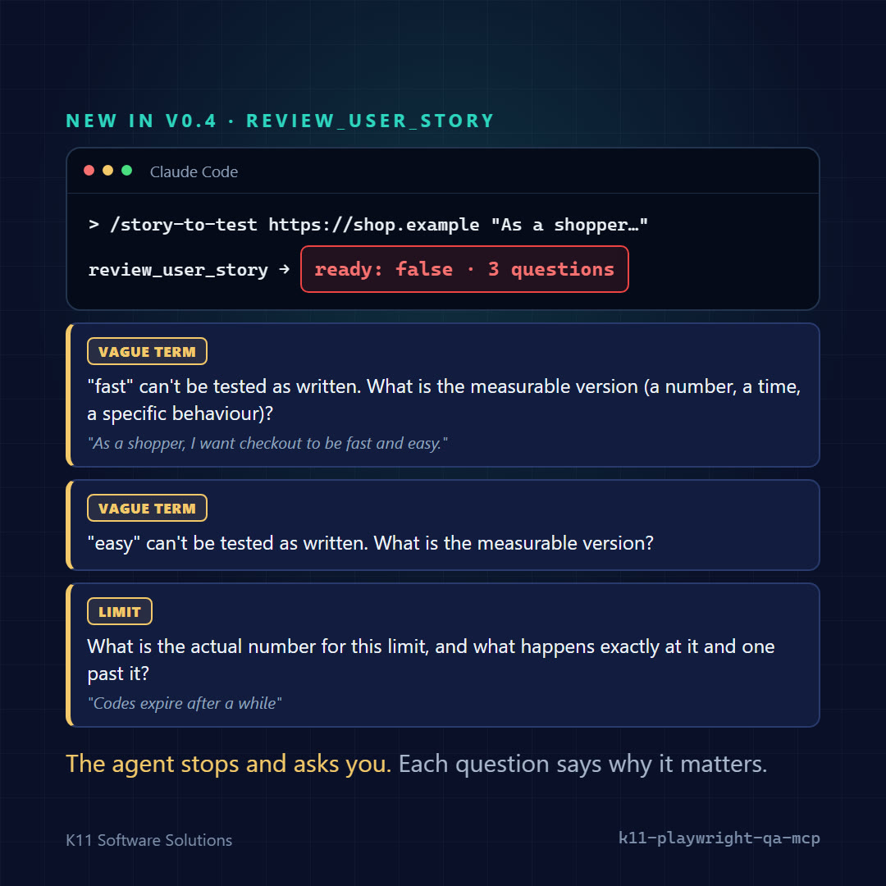
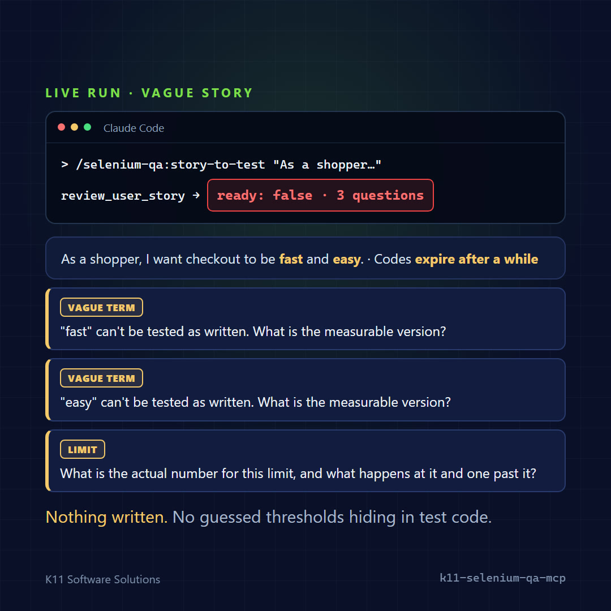

# K11 QA MCP demos

[](https://github.com/K11-Software-Solutions/k11techlab-qa-mcp-demos/actions/workflows/demos.yml)

A historical record of the first live runs of two Claude Code plugins:

- [k11techlab-playwright-qa-mcp](https://github.com/K11-Software-Solutions/k11techlab-playwright-qa-mcp) (0.4.1)
- [k11techlab-selenium-qa-mcp](https://github.com/K11-Software-Solutions/k11techlab-selenium-qa-mcp) (0.3.0)

It keeps everything from those runs:

- the inputs given to each plugin, and what each plugin did with them;
- the tests the plugins produced;
- what broke, and how it was fixed.

Both plugins turn a user story into a passing test through the same command, `/<plugin>:story-to-test <url> <story>`. The steps are:

1. **Ask before you build.** `review_user_story` finds what a careful tester would ask: vague words, limits with no numbers, missing acceptance criteria. If the story isn't ready, the agent stops and asks you.
2. **Parse.** `parse_user_story` produces scenarios and a test skeleton.
3. **Explore.** `explore_page` finds locators verified against the live page. The agent never guesses them.
4. **Write, run and heal.** `write_test`, `run_tests` and `heal_locator`.
5. **Baseline.** `capture_baseline` records locator fingerprints for later healing.

## Videos

| Playwright QA: ask before you build (58 s) | Selenium QA: ask before you build (76 s) |
|---|---|
| [](videos/playwright-qa-ask-first/playwright-qa-ask-before-you-build.mp4?raw=true) | [](videos/selenium-qa-ask-first/selenium-qa-ask-before-you-build.mp4?raw=true) |

Click a thumbnail to play. The sources and render steps are in [videos/](videos/).

## Results

| | Selenium (pytest) | Playwright (Playwright Test) |
|---|---|---|
| Vague story ("fast and easy", "after a while") | `ready: false`, 3 questions, nothing written | `ready: false`, 3 questions, nothing written |
| Answered story on example.com | Stopped: the page's `<h1>` is gone, reported as an app problem | Stopped: example.com has no shop |
| TodoMVC story, 5 acceptance criteria | **5/5 pass** in 26 s | **5/5 pass** in 5.5 s, first time |
| Tests | [selenium/tests/test_todo_items.py](selenium/tests/test_todo_items.py) | [playwright/tests/todo-items.spec.ts](playwright/tests/todo-items.spec.ts) |
| Sauce Demo checkout behind a login, 4 acceptance criteria | **4/4 pass** in 28 s: [test_buy_backpack.py](selenium/tests/test_buy_backpack.py). Credentials come only from env vars. | not run |

CI runs both TodoMVC suites against the live demo site on every push and every Monday. If a run
fails, either the suite or the demo site has changed.

## Layout

```text
inputs/        the exact stories given to the plugins
selenium/      pytest suite, baselines, live-run records, results, Selenium-specific issues
playwright/    Playwright suite, baselines, live-run records, results, Playwright-specific issues
videos/        the two demo videos, with thumbnails and their HTML sources
docs/
  ISSUES-AND-FIXES.md   everything that went wrong and how it was fixed (start here)
  TIMELINE.md           what happened, in order
  scripts/              the headless live-run harness and log converters
```

## Main lessons

- **The "ask first" behaviour held on every route:** command line, plugin installed from GitHub, and the desktop app. Neither plugin wrote a test from a vague story.
- **Install uv before the Selenium plugin.** If its server crashes once, Claude Code can record it in `~/.claude/mcp-needs-auth-cache.json` and stop starting it. Remove that entry, then start a **new** session. Details are in [issue 3](docs/ISSUES-AND-FIXES.md#3-claude-code-remembered-the-first-crash-as-needs-sign-in-root-cause).
- **Keep installed plugins current.** `npx -y` always fetches the latest server, but the slash command text only updates with `claude plugin update`.
- **Invisible-but-clickable controls:** TodoMVC's `opacity: 0` checkboxes are fine in Playwright, but Selenium needs a presence wait, then a click.
- **Pin your Selenium version.** 4.54.0 is broken on import.

## Run the suites

```powershell
cd selenium
uv venv .venv
uv pip install --python .venv\Scripts\python.exe -r requirements.txt
.venv\Scripts\python -m pytest tests -v
```

```powershell
cd playwright
npm ci
npx playwright install chromium
npx playwright test
```

---

Part of [K11 Tech Lab](https://github.com/K11-Software-Solutions).
