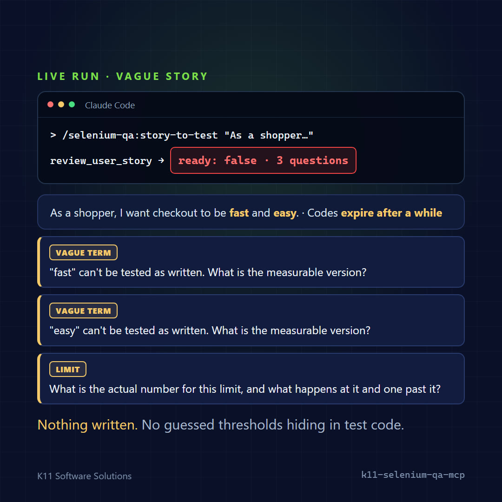
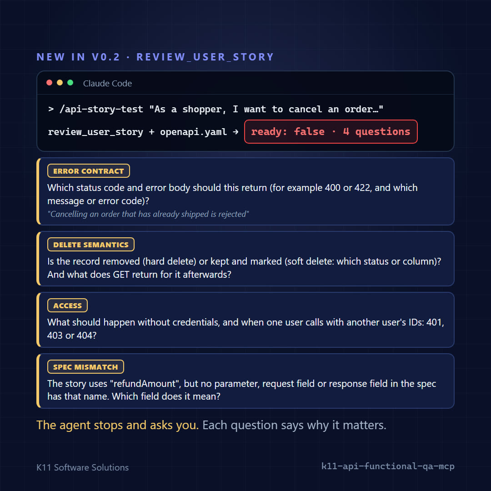
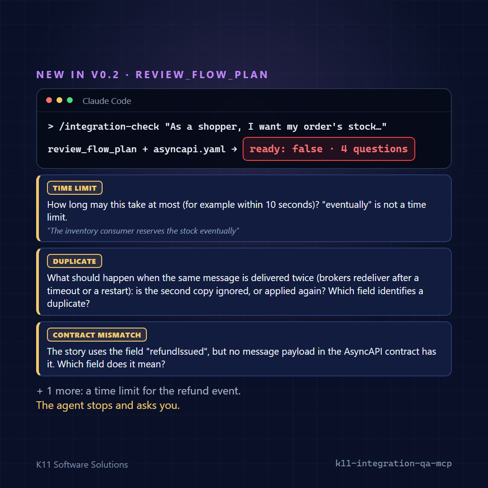
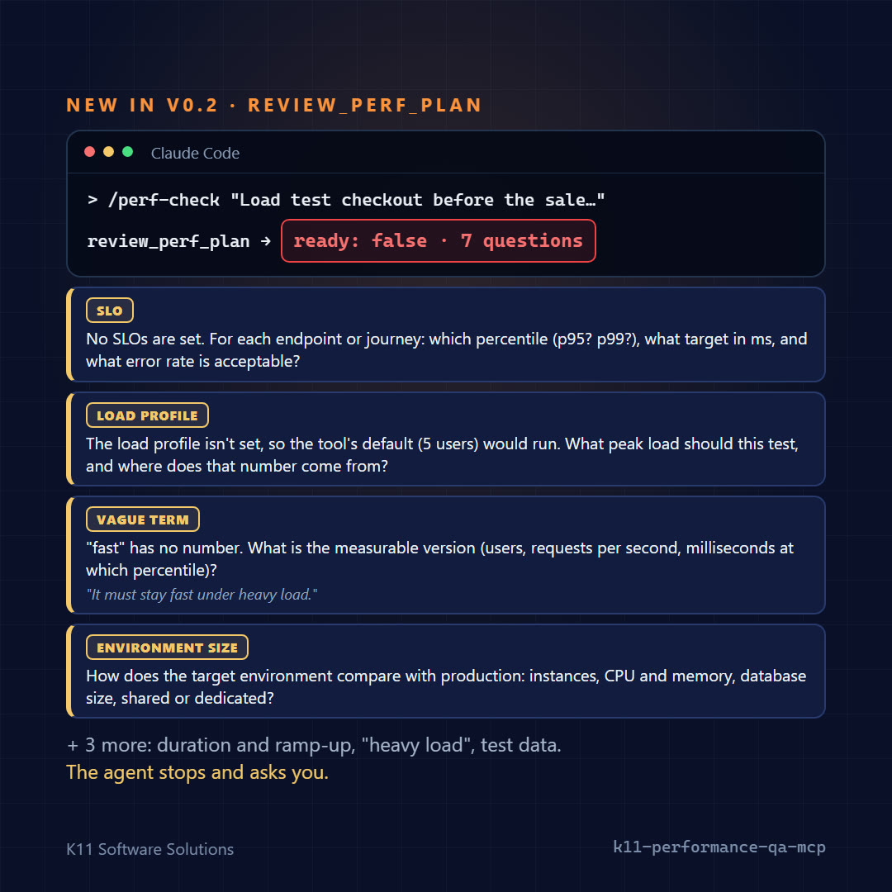

# Demo videos

Five short videos, one per tool, made for LinkedIn. Each is 1080×1080 H.264 at 30 fps.
Click a thumbnail to play the video.

## UI tools (2026-11-25)

| Playwright QA, v0.4.1 (58 s) | Selenium QA, v0.3.0 (76 s) |
|---|---|
| [](playwright-qa-ask-first/playwright-qa-ask-before-you-build.mp4?raw=true) | [](selenium-qa-ask-first/selenium-qa-ask-before-you-build.mp4?raw=true) |
| The problem (an LLM guesses), `review_user_story` asking 3 questions, the answered story, open questions written down instead of guessed, and deterministic behaviour. | The vague story stopped with 3 questions; the Sauce Demo login via `${ENV:...}`; verified `data-test` locators; 4/4 passing with 19 locators baselined; the agent refusing to weaken a test when the page was wrong; pytest, JUnit 5 and TestNG. |

## API, integration and performance tools (2026-11-27 and 2026-11-28)

| API Functional QA, v0.2 (69 s) | Integration QA, v0.2 (70 s) | Performance QA, v0.2 (70 s) |
|---|---|---|
| [](api-functional-qa-ask-first/api-functional-qa-ask-before-you-build.mp4?raw=true) | [](integration-qa-ask-first/integration-qa-ask-before-you-build.mp4?raw=true) | [](performance-qa-ask-first/performance-qa-ask-before-you-load-test.mp4?raw=true) |
| A vague "cancel an order" story gets 4 API questions from `review_user_story` with the OpenAPI spec: error contract, delete semantics, access, and a field the spec doesn't have. The answered story gets 0, and answers are judged per When→Then exchange. | `review_flow_plan` with the AsyncAPI contract asks 4 questions: a time limit for "eventually", what a duplicate delivery should do, and a field the contract doesn't have. The demo shop fails 0/4 with its bugs on and passes 4/4 with them off, and the report shows the closest message. | `review_perf_plan` asks 7 questions about "fast under heavy load" (SLOs, peak load, duration, test data, environment size) instead of running the 5-user default. A slower release is then flagged as a +69.5% p95 regression while every SLO still passed. |

## How they're made

Each folder has the source. Every video is a single HTML page with a `window.render(t)` timeline. A small Playwright script
renders it to PNG frames, and ffmpeg encodes the frames:

```bash
node render.cjs <path to node_modules/playwright> 30                 # writes frames/00000.png ...
node render.cjs <path to node_modules/playwright> 30 4,16,45         # only these seconds, into keyframes/ for checking
ffmpeg -framerate 30 -i frames/%05d.png -c:v libx264 -pix_fmt yuv420p -crf 20 -preset slow -movflags +faststart out.mp4
```

Every question, number and quote on screen comes from a real run:

- **Selenium QA:** [the vague-story run](../selenium/live-runs/03-vague-story-installed-plugin.md),
  [the Sauce Demo suite](../selenium/README.md#demo-2-sauce-demo-checkout-behind-a-login) and
  [the example.com report](../selenium/live-runs/02-answered-story-example-com.md).
- **API Functional QA:** `review_user_story` (0.2.2) run against the demo shop's `openapi.yaml`.
- **Integration QA:** `review_flow_plan` (0.2.0) run against the demo shop's `asyncapi.yaml`, and the demo
  runs recorded in [e2e-manual/examples/integration/](../e2e-manual/examples/integration/).
- **Performance QA:** `review_perf_plan` (0.2.0) and the baseline and slow-release runs recorded in
  [e2e-manual/examples/performance/](../e2e-manual/examples/performance/).

Long questions and stories are shortened on screen only where marked: "+ N more", "…" or "Given steps trimmed".
