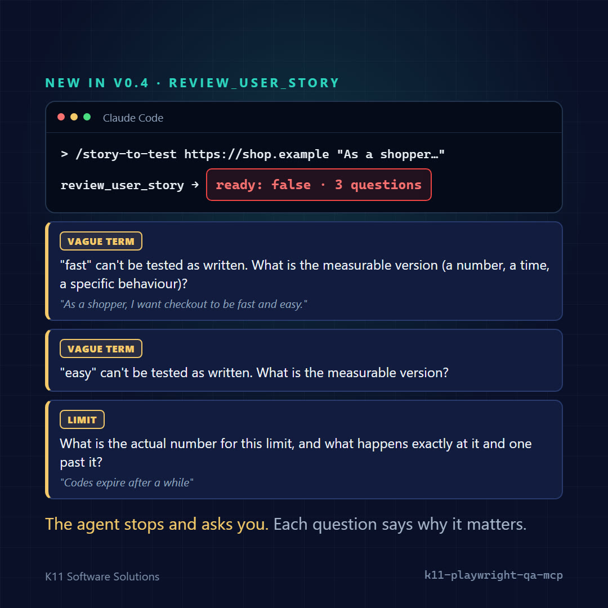

# Demo videos

Two short videos, one per plugin, made for LinkedIn on 2026-11-25. Both are 1080×1080 H.264 at 30 fps.
Click a thumbnail to play the video.

| Playwright QA, v0.4.1 (58 s) | Selenium QA, v0.3.0 (76 s) |
|---|---|
| [](playwright-qa-ask-first/playwright-qa-ask-before-you-build.mp4?raw=true) | [](selenium-qa-ask-first/selenium-qa-ask-before-you-build.mp4?raw=true) |
| The problem (an LLM guesses), `review_user_story` asking 3 questions, the answered story, open questions written down instead of guessed, and deterministic behaviour. | The vague story stopped with 3 questions; the Sauce Demo login via `${ENV:...}`; verified `data-test` locators; 4/4 passing with 19 locators baselined; the agent refusing to weaken a test when the page was wrong; pytest, JUnit 5 and TestNG. |

## How they're made

Each folder has the source. Every video is a single HTML page with a `window.render(t)` timeline. A small Playwright script
renders it to PNG frames, and ffmpeg encodes the frames:

```bash
node render.cjs <path to node_modules/playwright> 30                 # writes frames/00000.png ...
node render.cjs <path to node_modules/playwright> 30 4,16,45         # only these seconds, into keyframes/ for checking
ffmpeg -framerate 30 -i frames/%05d.png -c:v libx264 -pix_fmt yuv420p -crf 18 -preset slow -movflags +faststart out.mp4
```

Every number and quote in the Selenium video comes from the runs recorded in this repo:

- [the vague-story run](../selenium/live-runs/03-vague-story-installed-plugin.md)
- [the Sauce Demo suite](../selenium/README.md#demo-2-sauce-demo-checkout-behind-a-login)
- [the example.com report](../selenium/live-runs/02-answered-story-example-com.md)
